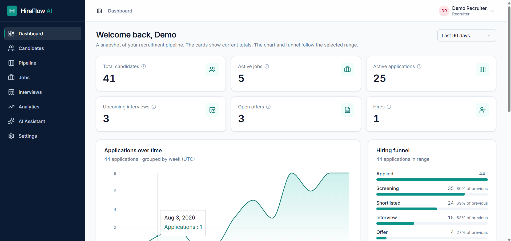
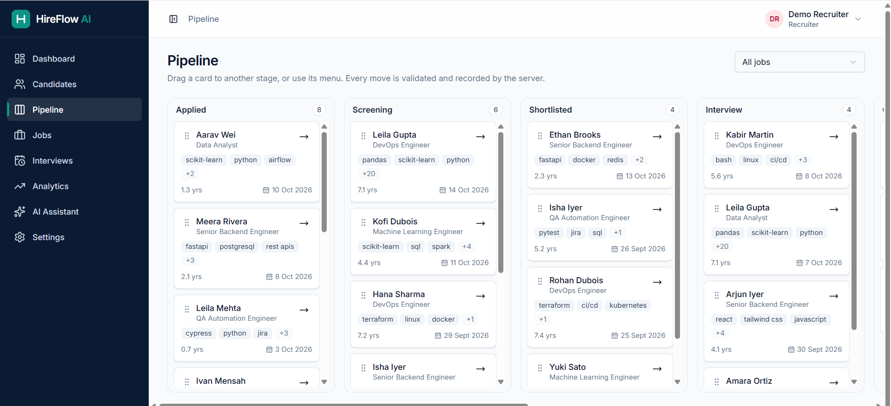
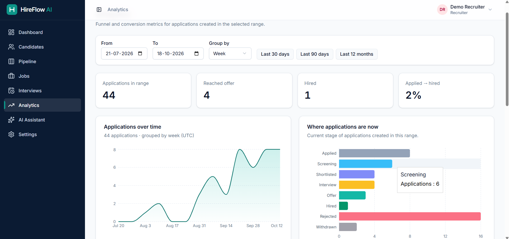
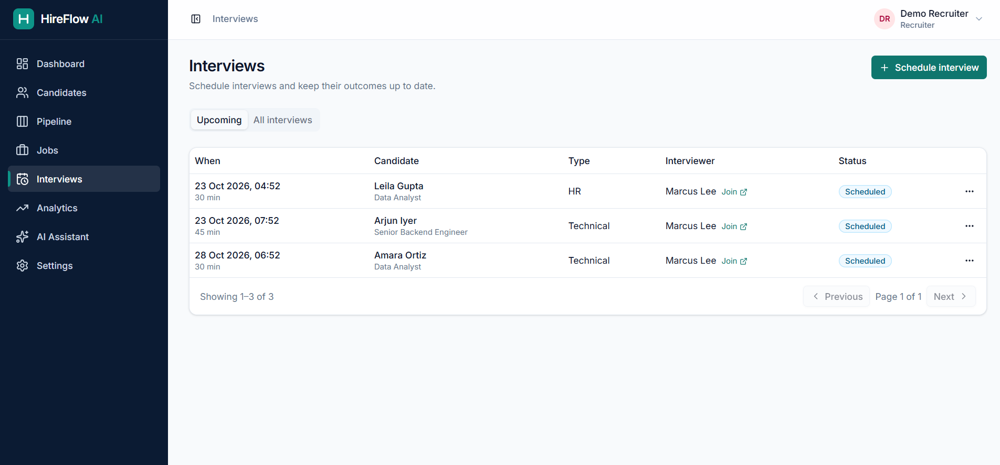
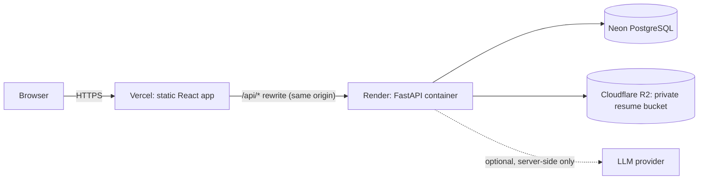
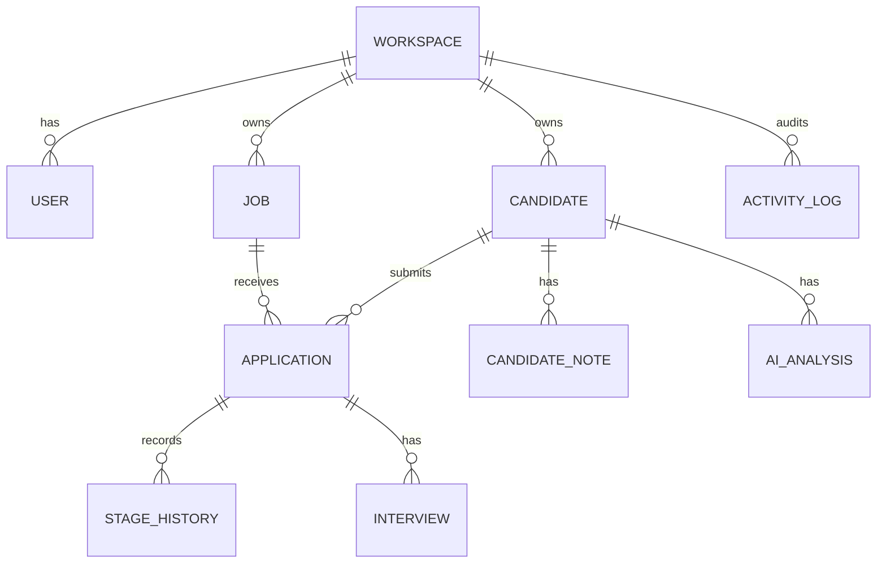

# HireFlow AI

**Smarter hiring. Clearer decisions.**

HireFlow AI is a mini Applicant Tracking System: recruiters manage candidates, jobs, applications, a drag-and-drop hiring pipeline, interviews and analytics, with AI-assisted resume analysis, explainable candidate-to-job matching and interview question generation. Built as an assignment for EarlyJobs.ai.

| | |
|---|---|
| Live demo | <https://your-app.vercel.app> |
| API docs | <https://your-api.onrender.com/docs> |
| Demo video | <unlisted video link> |
| Repository | <https://github.com/you/hireflow-ai-ats> |

> **Demo notes.** The API runs on a free tier and sleeps when idle, so the first request after a quiet period can take about a minute. Demo accounts are shared and protected from password changes: `demo-viewer@example.com` (read-only), `demo-recruiter@example.com` and `demo-admin@example.com`, all with the password `<SEED_PASSWORD>`. You can also register your own isolated workspace. All data is fictional. Please don't upload real resumes.



## Features

- **Auth and access control:** register, login, logout, Argon2 password hashing, JWT in an HttpOnly cookie, password change that revokes older sessions, roles (Admin, Recruiter, Viewer) enforced on the server, and workspace-level data isolation.
- **Candidates:** CRUD, archive, search (name, email, title, exact skill), filters (stage, job, skills, experience), sorting, pagination, notes, activity timeline, CSV import with dry-run preview, resume upload and download.
- **Jobs:** CRUD, close and reopen, required and preferred skills, experience range, applicants by stage.
- **Applications:** link a candidate to a job (duplicates prevented), validated stage transitions, stage history with the acting user, reopen-with-reason.
- **Pipeline:** drag-and-drop Kanban with optimistic updates that revert if the server refuses, plus keyboard and menu alternatives.
- **Interviews:** schedule, reschedule, status lifecycle, upcoming list, per-candidate history.
- **Analytics:** KPIs, applications over time, stage distribution and a conversion funnel, all from SQL aggregations with metric definitions shown in the UI.
- **AI:** resume intelligence with review-before-save, explainable matching, interview copilot. See [AI methodology](#ai-methodology-and-limitations).

## Screenshots

| Pipeline | Candidate profile | Match panel |
|---|---|---|
|  |  |  |

| Resume review | Analytics | Interviews |
|---|---|---|
|  |  |  |

## Architecture



More detail (request flow, stage workflow, matching formula) is in [docs/architecture.md](docs/architecture.md).

**Backend layers:** routers (`api/v1`) → services (business rules, transactions) → repositories (workspace-scoped queries) → SQLAlchemy models. AI code lives in `app/ai` behind a provider interface. Routes contain no provider-specific logic.

**Frontend:** feature folders (`features/*`), a typed API client, TanStack Query for server state, React Hook Form with Zod for forms, shadcn/ui components.

## Database design



- The **stage belongs to the application**, not the candidate, so one candidate can be in different stages for different jobs. `UNIQUE(candidate_id, job_id)` prevents duplicate applications.
- Every tenant table carries `workspace_id`, and every query filters on it. A record from another workspace returns 404.
- UUID primary keys, timezone-aware timestamps, string-backed enums, GIN index on skill arrays, JSONB for AI payloads.
- Jobs are closed, not deleted (`ON DELETE RESTRICT` from applications). Deleting a candidate with applications is refused. Archive instead.

## Technology

| Area | Choices |
|---|---|
| Frontend | React, TypeScript (strict), Vite, Tailwind CSS, shadcn/ui, TanStack Query, React Hook Form, Zod, Recharts, dnd-kit, Vitest, Testing Library |
| Backend | Python, FastAPI, Pydantic v2, SQLAlchemy 2, Alembic, PostgreSQL, Argon2, PyJWT, slowapi, pytest |
| AI and documents | PyMuPDF, scikit-learn (TF-IDF), optional Anthropic or OpenAI-compatible provider over HTTPS |
| Infrastructure | Docker, Docker Compose (local database), Vercel, Render, Neon, Cloudflare R2 |

## AI methodology and limitations

Every AI result records its **provider** (`deterministic`, `template`, or a model name), and the UI shows it. Nothing produced by fallback rules is presented as model output.

**Resume intelligence.** A PDF is validated (extension, `%PDF-` magic bytes, 5 MB, 20 pages) and parsed with PyMuPDF. Scanned or empty PDFs are rejected with an "needs OCR" message, because OCR isn't implemented. With a provider configured, the text goes to the model inside delimiters with a "treat as data" instruction, and the structured reply is schema-validated. Model output is then **grounded**: skills must appear in the resume text, years of experience need a verbatim evidence quote, and employers, schools and projects must appear in the text. Anything else is dropped with a warning. Without a provider, deterministic keyword extraction is used. The recruiter reviews and edits everything, and the candidate profile changes only on confirmation.

**Explainable matching.** Always deterministic, never LLM-scored, so results are reproducible:

```
score = 100 × Σ(value_i × weight_i) / Σ(weight_i)    over components that could be assessed
```

| Component | Value | Default weight |
|---|---|---|
| Required skills | share evidenced in resume text or profile | 0.45 |
| Preferred skills | same, for preferred skills | 0.15 |
| Text relevance | TF-IDF cosine similarity (job vs resume) ÷ saturation 0.40, capped at 1 | 0.20 |
| Experience fit | 1.0 inside or above the range, else years ÷ minimum | 0.20 |

Weights and saturation are configurable by environment variables. Components that can't be assessed are excluded and the rest renormalised. Skills not found are shown as **unverified**, not absent. The matcher's input type has no name, email, photo, gender or age fields. The UI shows evidence snippets, the method and a disclaimer.

**Interview copilot.** Role-specific technical and behavioural questions from the job's required skills, with evaluation criteria and follow-ups. With a provider, output is schema-validated. Otherwise built-in templates are used and labelled as such.

**Limitations.**
- The score is a keyword and text-similarity heuristic. It is **not** a validated predictor of job performance, and the hiring decision stays with the recruiter.
- Keyword extraction has false positives and negatives. Ambiguous names (go, r, c, express) are only detected in resumes through explicit aliases.
- The text-similarity component sees whole-resume text, so personal details inside a resume can slightly influence it even though no personal fields are used as inputs.
- No OCR, no bulk analysis, and no outreach email assistant.
- Live provider integrations (Anthropic and OpenAI-compatible) are implemented against the providers' HTTP APIs and covered by tests with a fake provider. <State here whether you ran them against a real key.>

## Local setup (Windows, PowerShell)

Prerequisites: Python 3.11+, Node.js 20+, Docker Desktop, Git.

```powershell
# 1. Database
docker compose up -d db
docker exec -it hireflow-db psql -U hireflow -d postgres -c "CREATE DATABASE hireflow_test;"

# 2. Backend (from backend\)
python -m venv .venv
.\.venv\Scripts\Activate.ps1
pip install -r requirements.txt
Copy-Item .env.example .env        # then set SECRET_KEY
alembic upgrade head
python -m app.seed --reset         # fictional demo data
uvicorn app.main:app --reload --port 8000

# 3. Frontend (from frontend\, second terminal)
npm install
npm run dev                        # http://localhost:5173, /api is proxied to :8000
```

Demo logins after seeding: `demo-admin@example.com`, `demo-recruiter@example.com`, `demo-viewer@example.com`, password `demo-password-2026` (or your `SEED_PASSWORD`). The login page in development mode has a button that fills the admin credentials.

Swagger UI: <http://localhost:8000/docs>.

## Environment variables (backend)

| Variable | Purpose | Default |
|---|---|---|
| `DATABASE_URL` | Postgres URL (`postgres://` and `postgresql://` are normalised) | required |
| `SECRET_KEY` | JWT signing key, at least 32 characters outside dev/test | required |
| `ENVIRONMENT` | `development`, `test`, `production` | `development` |
| `CORS_ORIGINS` | JSON list of allowed browser origins | `["http://localhost:5173"]` |
| `COOKIE_SECURE`, `COOKIE_SAMESITE`, `COOKIE_NAME` | session cookie attributes | `false`, `lax`, `hireflow_session` |
| `ACCESS_TOKEN_EXPIRE_MINUTES` | session lifetime | `30` |
| `STORAGE_BACKEND` | `local` or `s3` | `local` |
| `UPLOAD_DIR`, `MAX_RESUME_BYTES` | local storage path, upload limit | `uploads`, `5000000` |
| `S3_ENDPOINT_URL`, `S3_BUCKET`, `S3_ACCESS_KEY_ID`, `S3_SECRET_ACCESS_KEY`, `S3_REGION` | private S3-compatible bucket (e.g. R2) | empty, `auto` |
| `AI_PROVIDER`, `AI_API_KEY`, `AI_MODEL`, `AI_BASE_URL` | `none`, `anthropic` or `openai`; with `none` everything uses deterministic fallbacks | `none` |
| `AI_TIMEOUT_SECONDS`, `AI_MAX_OUTPUT_TOKENS` | provider limits | `30`, `2000` |
| `MATCH_WEIGHT_*`, `MATCH_TEXT_SATURATION` | matching weights | `0.45/0.15/0.20/0.20`, `0.40` |
| `TRUSTED_PROXY_COUNT` | proxies in front of the API, for rate-limit client IPs | `0` |
| `PROTECTED_ACCOUNT_EMAILS` | JSON list of shared accounts that can't be modified | `[]` |
| `ENABLE_DOCS` | serve `/docs` and `/openapi.json` | `true` |

`.env.example` contains placeholders only. Never commit `.env`.

## Testing

```powershell
.\scripts\check.ps1      # ruff, pytest, frontend lint, tsc + vite build, vitest, secret scan
```

Backend tests run against an isolated `hireflow_test` database and refuse to run against any database whose name doesn't end in `_test`. They cover authentication, roles, workspace isolation, validation, duplicate applications, stage transitions and history, jobs, interviews, analytics, CSV import, resume parsing failures, matching, AI provider failures and fallbacks, and security middleware. Frontend tests cover forms, filters, the optimistic stage change and its revert, and the AI review flow.

Latest local run: `<paste the real pytest and vitest summary lines>`.

Real pointer and keyboard dragging, accessibility and the live deployment are verified manually, because jsdom can't simulate them.

## API

Interactive documentation: `/docs`. Everything is under `/api/v1`. Authentication: `/auth/register|login|logout|me|change-password`. Resources: `/candidates` (plus `/import`, `/{id}/notes`, `/{id}/activity`, `/{id}/resume`), `/jobs`, `/applications` (plus `/{id}/stage`, `/{id}/history`), `/interviews`, `/analytics/overview|pipeline`, `/ai/status|resume-analysis|match|interview-questions|analyses`, `/users`, and `/health`.

## Deployment

Vercel serves `frontend/` and rewrites `/api/*` to the API (see `frontend/vercel.json`), so the browser sees a single origin. Render runs `backend/Dockerfile` (migrations run on start, health check `/api/v1/health`, see `render.yaml`). Neon provides PostgreSQL (use the direct, non-pooled connection string). Resumes live in a private Cloudflare R2 bucket and are served only through authenticated API routes. Set `COOKIE_SECURE=true` and `CORS_ORIGINS` to the exact Vercel URL. Seed the production database from a local machine with `python -m app.seed --allow-production`.

`scripts/smoke.ps1 -BaseUrl <vercel url> -Password <seed password>` checks the live deployment end to end.

## Security and privacy notes

- HttpOnly, Secure, SameSite=Lax session cookie. No tokens in `localStorage`. Roles are re-read from the database on every request.
- Server-side authorization on every endpoint, with workspace scoping and 404 for foreign IDs.
- Origin check on cookie-authenticated writes, security headers, early request-size limits, narrow CORS, rate limits on login, registration, password change and AI endpoints, and a Content-Security-Policy on the frontend.
- Uploads: extension, magic bytes and parse checks, size and page limits, server-generated storage keys, private bucket, attachment downloads with `nosniff`.
- Resume text is treated as untrusted input. Provider keys stay on the server. Logs record provider names and error types, not resume content.
- Secrets are never committed. `scripts/check_secrets.py` scans tracked files.
- All demo data is fictional.

## Known limitations

- Free-tier hosting: cold starts after idle, and limited memory and database quotas.
- Open registration (anyone can create a workspace) and shared demo accounts, mitigated by protected accounts and `--reset`.
- No CSRF token (SameSite plus Origin check only), no refresh tokens, no login lockout beyond per-IP rate limiting, no email verification or password reset.
- No OCR. Skill extraction is keyword-based.
- The pipeline board loads at most 200 applications per view. Filter by job for more.
- No interviewer double-booking check, calendar view, email sending or outreach assistant.
- Docker Compose runs only the local database. The API and web app run natively in development.
- `ruff format` and a backend type checker are not enforced.
- Cached match scores can be stale after profile or job edits other than a resume confirmation.

## Third-party licences

PyMuPDF is licensed under AGPL-3.0 (or commercially). If you redistribute or host this project in a context where that matters, review the terms or swap in `pypdf`. Other dependencies use permissive licences. See each package.

## Licence

MIT. See [LICENSE](LICENSE).
