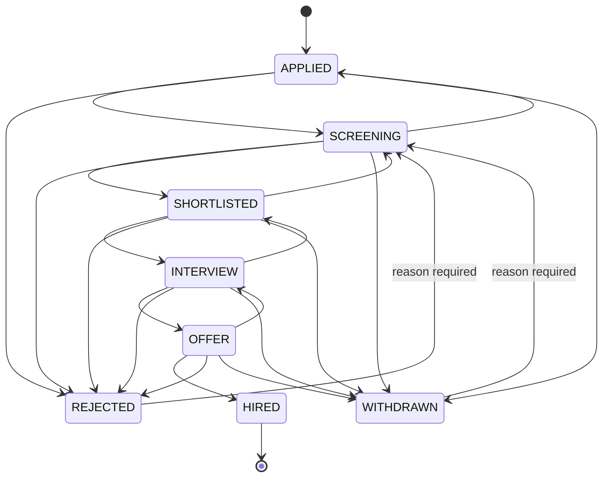

# Architecture notes

## Request flow

1. The browser calls `/api/...` on the Vercel origin. A rewrite proxies it to the API, so cookies are first-party.
2. Middleware (outermost first): security headers → body-size limit → Origin check → CORS.
3. A router dependency authenticates (cookie or Bearer token), loads the user from the database (role and active flag are never trusted from the token), and rejects tokens issued before the user's last password change.
4. Writes require `ADMIN` or `RECRUITER`. User management requires `ADMIN`.
5. A service applies business rules and commits. Repositories always filter by `workspace_id`.

## Application stage workflow

Rules live in one pure module (`app/core/workflow.py`). Stage changes lock the application row (`SELECT ... FOR UPDATE`), write a `stage_history` row and an activity log entry in the same transaction. The frontend pre-checks the allowed stages for a smoother experience, but the server is the authority.

## Metric definitions

- KPI cards are current snapshots. **Active applications** are in Applied, Screening, Shortlisted, Interview or Offer. An **offer** (currently in Offer) is not a **hire** (currently in Hired).
- Charts and the funnel use a cohort of applications by `applied_at` within the date range (UTC buckets).
- The **funnel** counts distinct applications that ever reached each stage, from `stage_history`, so later rejections still count where they got to. Conversion is reached(n) ÷ reached(n−1), and null when the denominator is 0.

## Matching

See the README formula. Implementation: `backend/app/ai/matcher.py`. Skill evidence comes from `backend/app/ai/skills.py` (alias normalisation plus boundary-aware search). Each run is stored as an `ai_analyses` row, and the latest score is cached on the application for the pipeline and job views. Confirming a resume clears cached scores.

## Resume pipeline

Upload → validate → extract text → (provider or deterministic extraction) → grounding checks → store unconfirmed analysis → recruiter review → confirm → candidate profile updated and cached scores cleared. The PDF is stored under a server-generated key in a private bucket.

## Deployment topology and constraints

Vercel (static) → rewrite → Render (Docker, free instance, sleeps after idle) → Neon (scale-to-zero Postgres) and R2 (private bucket). Free-tier limits and the cold start are documented in the README.
